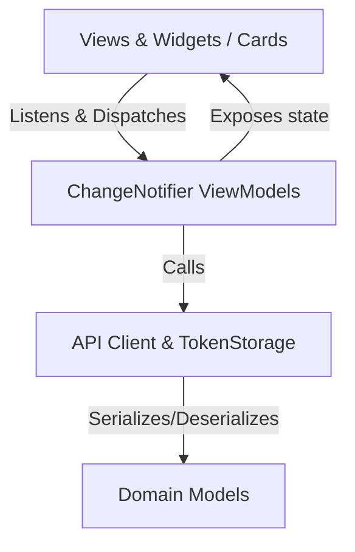

# Architecture Pattern & Design

## Pattern: MVVM (Model-View-ViewModel)
The application adheres strictly to the **MVVM** pattern separated across distinct feature modules:

### 1. Presentation Layer (Views & Modular Cards)
- Views are `StatelessWidget` or `StatefulWidget` instances that listen to their corresponding `ChangeNotifier` ViewModel using `AnimatedBuilder`, `ListenableBuilder`, or manual subscription.
- Complex screens are broken down into isolated card widgets under a `widgets/` directory for each feature:
  - Header cards (`CustomerHeaderCard`, `ProfileHeaderCard`)
  - Interactive cards (`ContactActionsCard`, `LeadFormCard`, `ScheduleFieldCard`)
  - Document management cards (`CustomerDocumentsCard`, `LeadDocumentUploadCard`)

### 2. ViewModel Layer (State & Logic)
- Each core feature maintains its own dedicated ViewModel extending `ChangeNotifier`:
  - `LoginViewModel`: Handles authentication lifecycle, error handling, token dispatch.
  - `TodayViewModel`: Manages search filters, tab indices (All, Unread, Pending), status filters, API sync.
  - `CustomerDetailsViewModel`: Handles contact manipulation, status updates, document attachments.
  - `AddBookingViewModel` & `AreaViewModel`: Handles lead intake, area validation, and multi-step forms.
  - `SettingsViewModel`: Handles preferences, theme selection, logout flows.
- **Dependency Inversion**: ViewModels accept optional dependencies in constructors (e.g., `http.Client? client`, `TokenStorage? tokenStorage`) to facilitate unit testing without external side effects.

### 3. Model Layer (Data & Serialization)
- Domain entities implement `fromJson` and `toJson` methods:
  - `UserModel` (`lib/login_page/login_model.dart`)
  - `BookingModel` (`lib/today/today_model.dart`)
  - `CustomerDetailsModel` (`lib/customer_details/customer_details_model.dart`)
  - `AreaModel` (`lib/new_booking/area_model.dart`)
  - `SettingsModel` / `UserProfileData` (`lib/settings/settings_model.dart`)

### 4. Navigation & App Shell
- [`lib/bottom_navigator/bottom_navigator.dart`](file:///c:/task_chat/lib/bottom_navigator/bottom_navigator.dart) serves as the persistent root app shell:
  - Manages floating bottom navigation bar
  - Dynamically routes tabs based on user role (Coordinator / SuperAdmin / Standard Staff)
  - Custom transition animations via `SlideUpRoute` (`lib/core/slide_up_route.dart`)

### 5. Theme & Token Architecture
- Centralized theme controller in [`lib/core/theme.dart`](file:///c:/task_chat/lib/core/theme.dart):
  - Single-variable primary green token (`AppColors.primaryGreen = Color(0xFF16A34A)`) drives all brand highlights across the entire app.
  - `ThemeController.instance` provides reactive `ValueNotifier<ThemeMode>` allowing dark/light toggle with zero full-app rebuild overhead.
